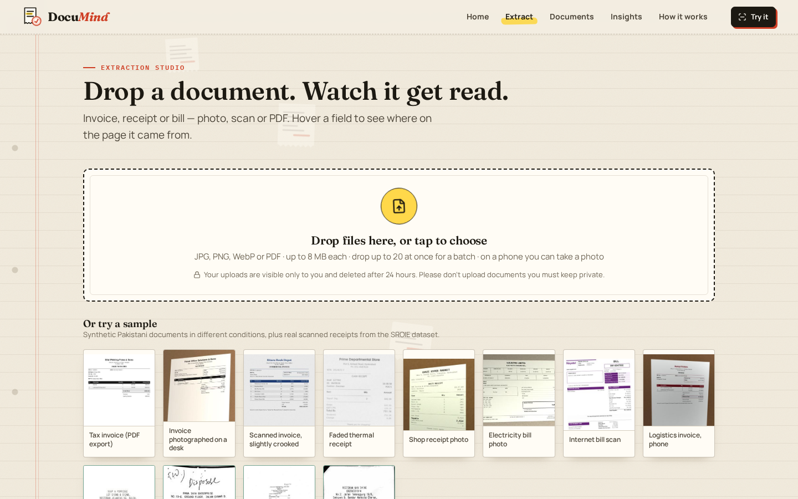
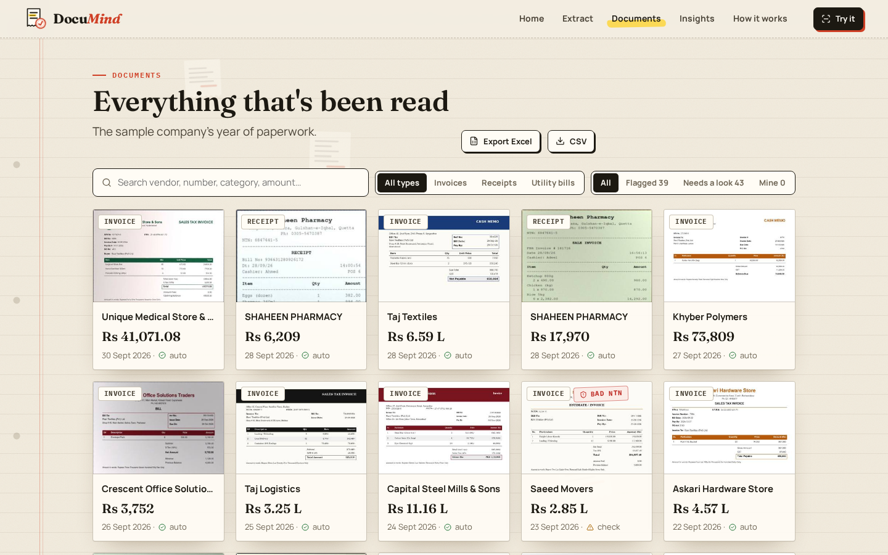
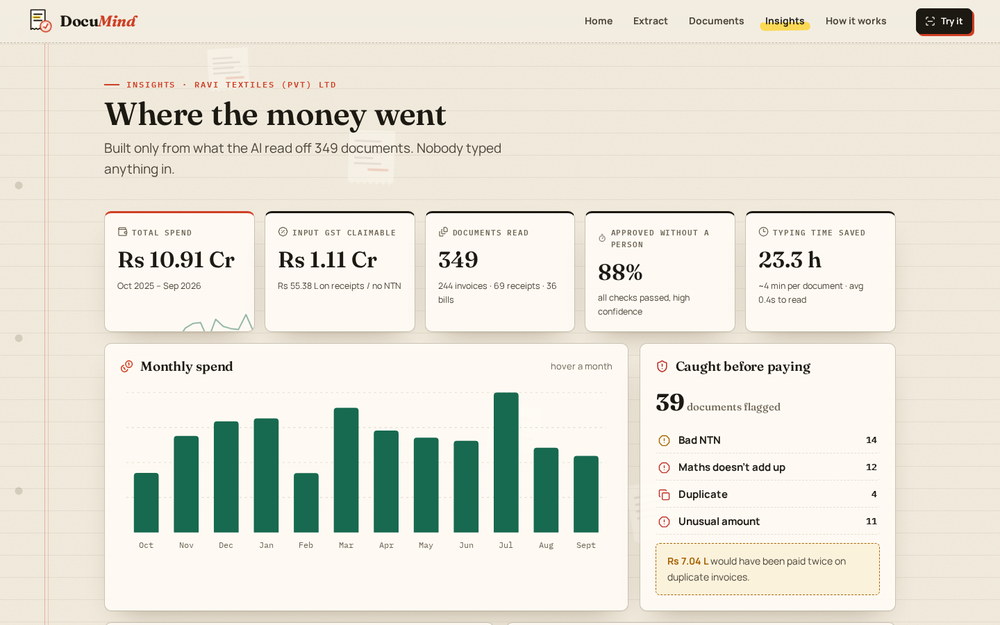
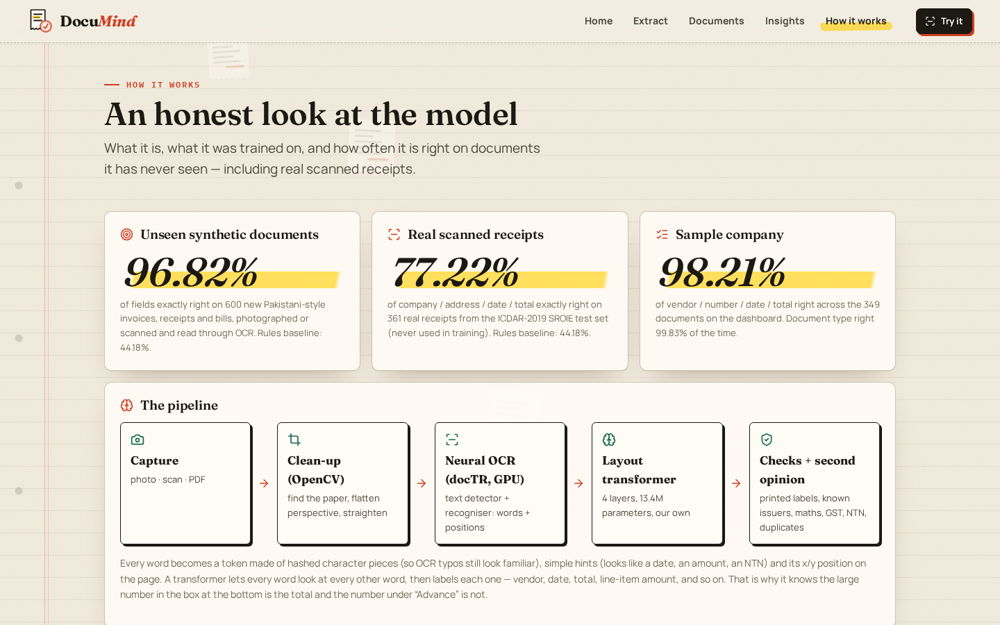
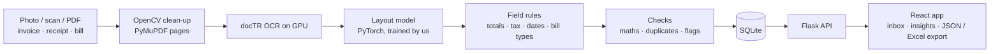

# DocuMind

**Document AI & OCR**

Document AI for invoices, receipts and bills. Snap a photo, a scan or a PDF and DocuMind reads the vendor, NTN, document number, dates, line items, sales tax and total, checks that the numbers add up, and flags duplicates and tampered totals.

[**Open the live demo**](https://documind.twinstackstudio.com) · [**Work with TwinStack Studio**](https://twinstackstudio.com/contact)

> **Note:** The Pakistani training and test documents are synthetic, so real vendor layouts will score lower until it is fine-tuned on a few hundred real documents. English print only: no Urdu and no handwriting. Uploads in the demo are deleted after 24 hours.

## What it does

- Page detection, flattening and deskew with OpenCV, then neural OCR (docTR) on the GPU
- A layout transformer trained from scratch labels every word on the page: 96.8% of fields exactly right on 600 new Pakistani-style documents
- 77.2% of company, address, date and total exactly right on real receipts from the SROIE test set it never trained on
- Cross-checks every document: line items add up, subtotal plus GST equals the total, the GST rate is real, NTN format and dates
- Recognises well-known issuers such as PTCL, K-Electric, LESCO and SNGPL
- Dashboard with spend insights, duplicate and unusual-amount flags, and export to JSON or Excel
- Batch mode reads many documents at once

## Screenshots

| Extract | Inbox |
| --- | --- |
|  |  |

| Insights | Model |
| --- | --- |
|  |  |

## Technology

| Layer | Stack |
| --- | --- |
| Document AI | PyTorch, docTR OCR, Tesseract, OpenCV |
| Language AI | Self-hosted LLM |
| Backend | Python, Flask, SQLite, PyMuPDF |
| Frontend | React, Vite, Framer Motion |

## Architecture

## Source code

This is the public showcase. The source code is kept in a private repository. Try the live demo above, and [contact TwinStack Studio](https://twinstackstudio.com/contact) for a walkthrough or a similar project.

## Built by TwinStack Studio

TwinStack Studio builds full-stack websites, web applications, mobile apps,
dashboards, portals, automation, and AI-powered products.

[GitHub](https://github.com/twinstack-studio) ·
[Website](https://twinstackstudio.com) ·
[Email](mailto:hello@twinstackstudio.com)

© 2026 TwinStack Studio. All rights reserved. See [LICENSE](./LICENSE).
