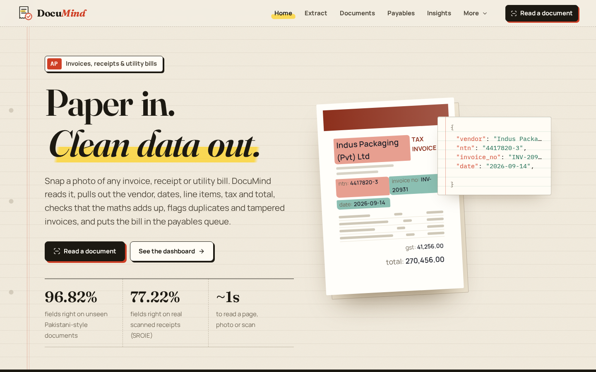
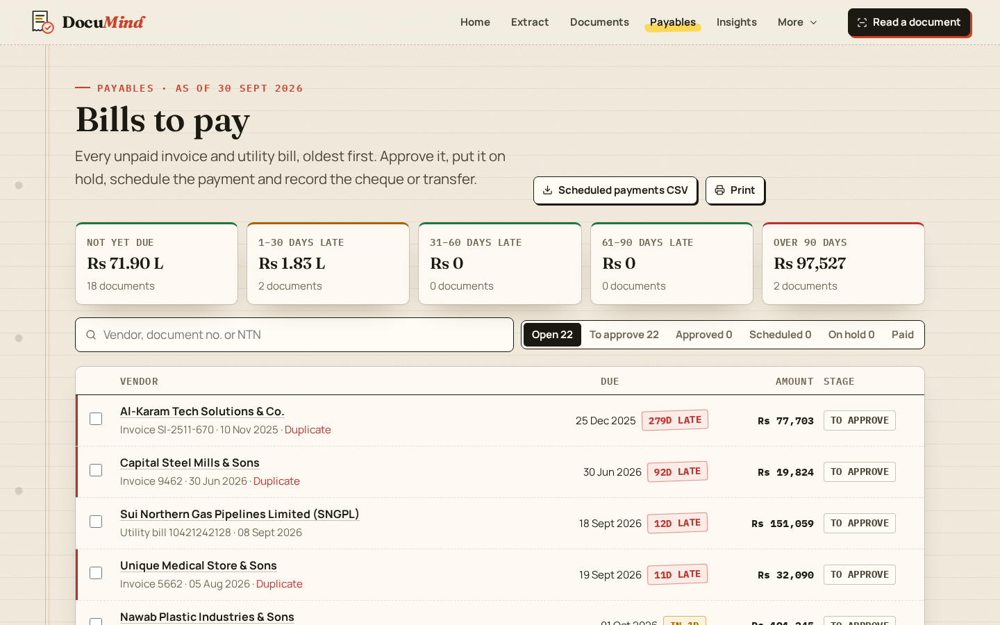
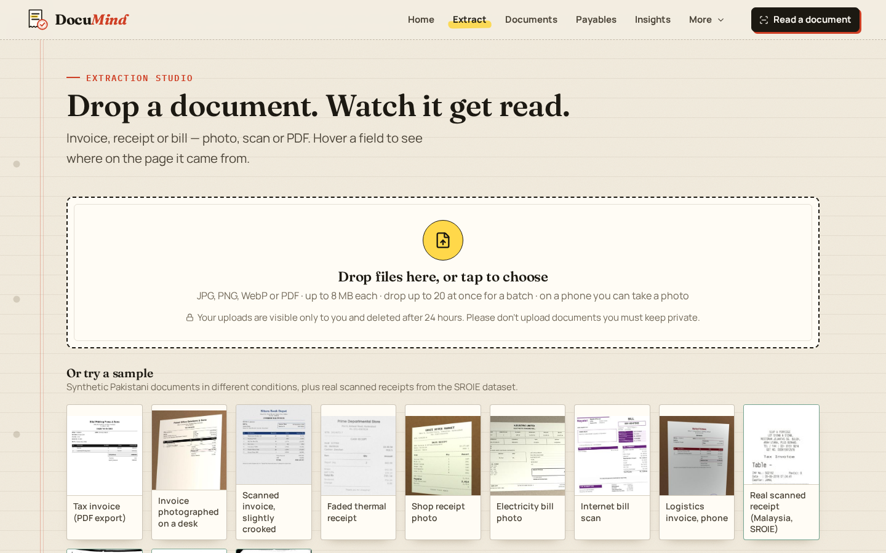
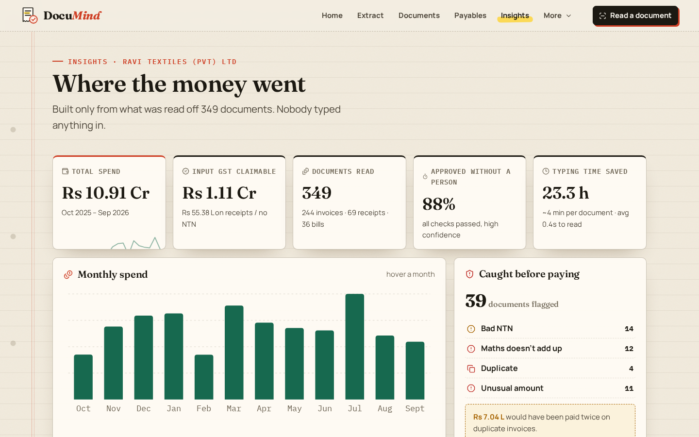
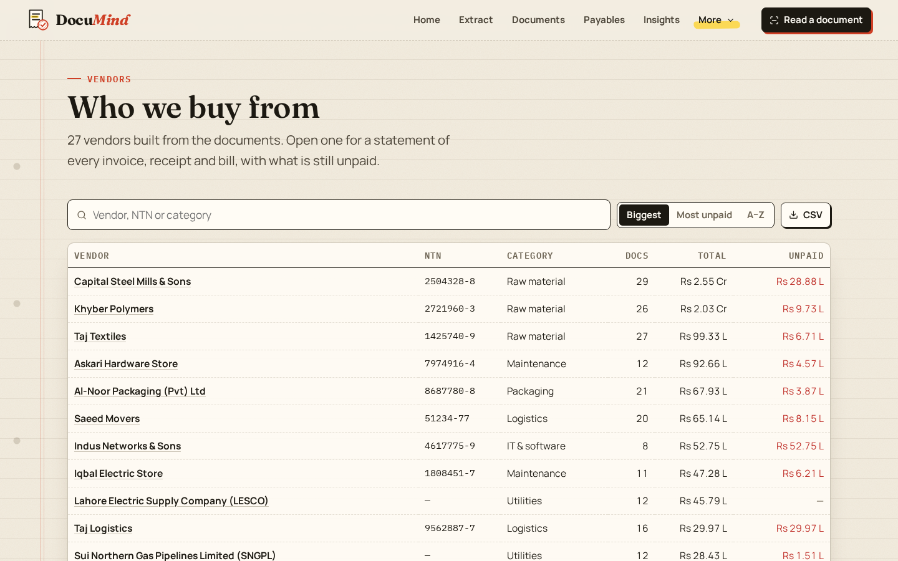
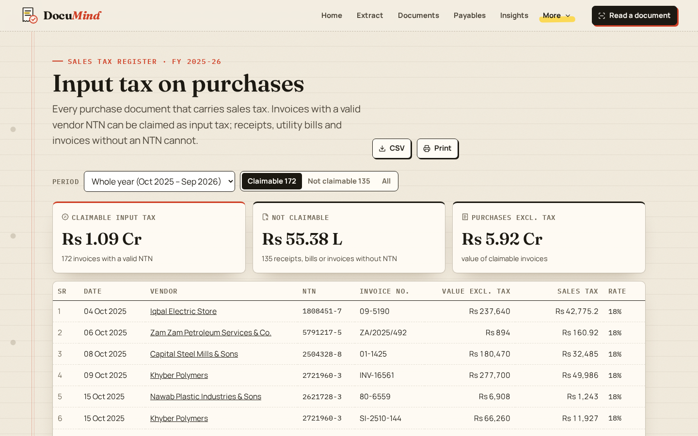
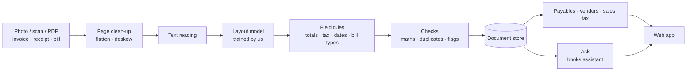

# DocuMind

Accounts payable for invoices, receipts and bills. Snap a photo, a scan or a PDF and
DocuMind reads the vendor, NTN, document number, dates, line items, sales tax and total,
checks that the numbers add up, and puts the bill in the payables queue.

**Live:** https://documind.twinstackstudio.com

## What it does

- **Read a document** — drop one file or a whole batch; every field is highlighted on the
  page where it was found, so a clerk can see where each value came from.
- **Checks** — line items add up, subtotal plus sales tax equals the total, the tax rate is
  real, NTN format and dates are valid; duplicates and tampered totals are flagged before
  anyone pays them.
- **Utility bills** — recognises well-known issuers such as PTCL, K-Electric, LESCO and SNGPL.
- **Payables** — every unpaid invoice and bill, oldest first, in five ageing bands. Approve,
  hold, schedule or mark paid with a cheque or transfer reference; every step is kept in a
  history that can be undone. Export the payment run as CSV or print it.
- **Vendor statements** — every supplier's documents with a running balance of what is
  still unpaid, CSV export and print.
- **Sales tax register** — month by month input tax on purchases, split into claimable
  (valid vendor NTN) and not claimable, with CSV export and print.
- **Insights** — monthly spend, spend by category and vendor, and everything that was
  caught before paying.
- **Ask** — any question about the books in English, Urdu or Roman Urdu ("how much do we owe
  Khyber Polymers?", "is mahine kitna tax claim ho sakta hai?"). Totals are worked out from
  the documents first, so every figure it quotes is real.
- Export to JSON or Excel. The layout and type scale from a 320 px phone to a 2560 px screen.

| Read a document | Insights |
| --- | --- |
|  |  |

| Vendor statements | Sales tax register |
| --- | --- |
|  |  |

## Accuracy, honestly

| Measure | Result |
| --- | --- |
| Fields exactly right on 600 new Pakistani-style documents | 96.8% |
| Company, address, date and total exactly right on real receipts (SROIE test set, never trained on) | 77.2% |

The Pakistani training and test documents are synthetic, so real vendor layouts will score
lower until it has seen a few hundred real documents. English print only: no Urdu and no
handwriting. The demo company, Ravi Textiles, and its vendors are fictional. Uploads in the
demo are deleted after 24 hours.

## Architecture

## Source code

This is the public showcase. The source code is kept in a private repository. Try the live demo above, and [contact TwinStack Studio](https://twinstackstudio.com/contact) for a walkthrough or a similar project.

© 2026 TwinStack Studio. All rights reserved. See [LICENSE](./LICENSE).
